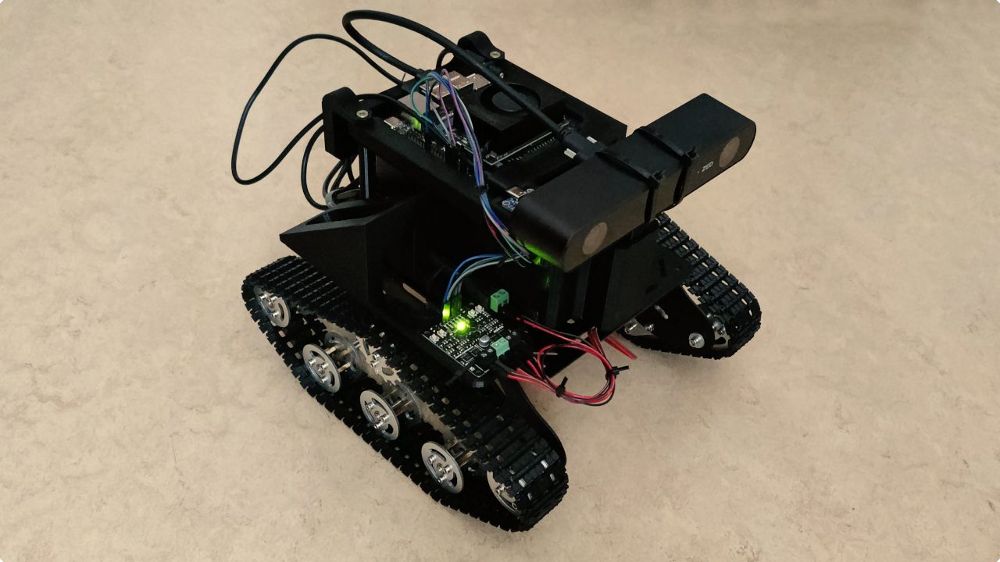
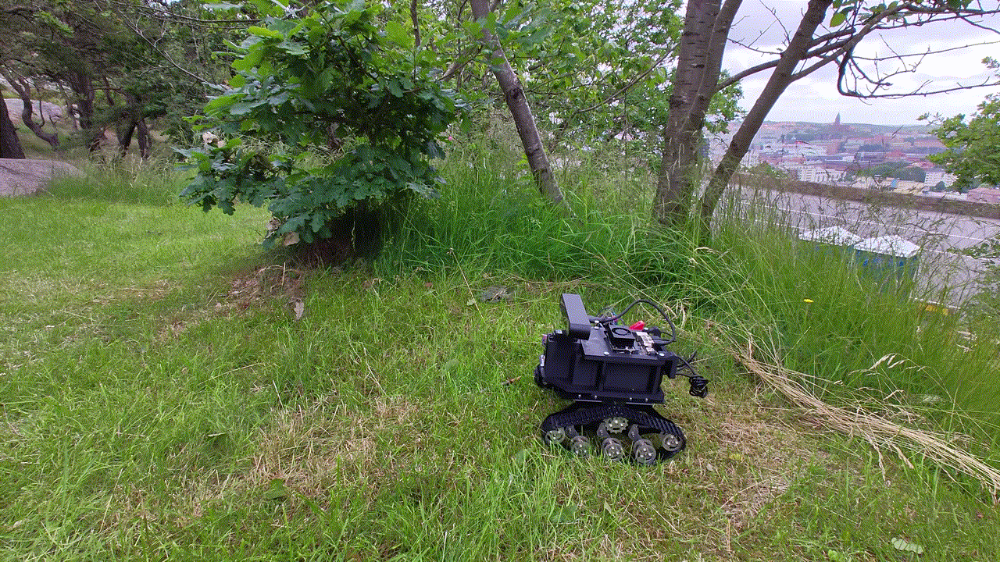

# Robot Controller From Scratch
First attempt at a robot control system from scratch. This project came to be as an afterthought from our 
bachelor thesis project a few years back. This was made as a recreational programming exercise for myself 
and entirely without the usage of AI. I am sharing the code incase someone else wants to have a go at it 
or found some inspiration from this smaller robot project.

This project is a Python based control system for a small tracked robot, built around an NVIDIA Jetson Orin 
Nano and a Stereolabs ZED 2i stereo camera. The Jetson handles motor control, sensor data and route planning
using the camera’s depth sensing and positional tracking to map the surrounding terrain. A separate desktop 
application connects over via wifi, allowing the user to drive the robot manually or select a destination for autonomous navigation. Autonomous mode uses A* pathfinding across the camera-generated mesh with optional GPS 
support for specifying destinations. The project applies a client/server design where the robot acts as the 
server and the controling device connects to the robot as a client.

## Preview




## Setup and run
The robot and client run separately but should use the same version of this project.

### Robot — NVIDIA Jetson
1. Connect all the hardware: camera, GPS receiver, motors, motor driver and power supply.
2. Connect GPIO hardware pins according to the [Jetson.GPIO documentation](https://github.com/NVIDIA/jetson-gpio). 
On my jetson orin nano I used pins **33 and 15 for forward control** and **29 and 31 for reverse control**.
Reverse control did not use PWM for directional power, it instead used PWM to reduce the reverse signal which 
was always high during reversing.
3. Install a JetPack release and [ZED SDK](https://www.stereolabs.com/developers/release/) compatible with 
your Jetson. Do confirm that the corresponding ZED Python API supports your Python version on Jetson, the 
Jetson's tend to run older versions of python by default.
4. Ensure your user has permission to access the GPS serial device. The code currently expects it at `/dev/ttyUSB0`,
change this in `server/modules/gps.py` if necessary.

Install the robot dependencies, use a virtual environment if you prefer:
```bash
python3 -m pip install -r requirements-robot.txt
```

Install the ZED Python API using the script supplied with the SDK:
```bash
python /usr/local/zed/get_python_api.py
```

See the [ZED Python API installation guide](https://www.stereolabs.com/docs/development/python/install) for 
platform specific instructions.

Start the robot controller:
```bash
python server/main.py
```

The server currently listens on TCP port **12345**, since this is a local network only device the specific port 
choice is arbitrary. So only run it on a trusted, isolated network!

### Client — Control device

Install the client dependencies:

```bash
python3 -m pip install -r requirements-client.txt
```

Start the client:

```bash
python client/main.py
```

Connect both devices to the same local network. Enter the Jetson's IP address in the client, then select manual or autonomous mode. Any firewall on the Jetson must allow incoming TCP connections on port **12345**.

## Components used
* Cytron Technologies MDD3A Motor Driver 3Amp 4V-16V DC
* Adafruit Ultimate GNSS/GPS (MTK3339)
* StereoLabs ZED 2i Stereo Camera
* Nvidia Jetson Orin Nano SBC
* Sandberg Powerbank USB-C PD 130W 50000mAH
* Generic tracked chassi platform with 2x 9V 150rpm DC brush motors
* 3D printed chassi mounts

## Final thougths
Given the power of hindsight I would do a few things different whenever I try this again, important lessons 
were learned. For starters doing navigation requires considerably more performance than I first thought. The ZED 
sdk supports python, C# and C++. Python, that I decided to use, being the slowest of the three when running any
computationally heavy code was maybe not ideal. Rewriting the whole thing in C++ just to observe the performance
difference would be an interesting experiment in the future. An alternative to this is to offload more of the
computation load away from the actual robot and onto the controling device instead. So the goal would simply be 
to gather the information and to pass it to the controling device as quickly as possible and let that device 
carry the heavy load instead. Secondly the whole manual control module would need to be rewritten from the ground 
up, it came to be as a bit of an afterthought so it's very simple and naive in it's design. However, all in all 
this proved to be a very educational project and this is definately one of the most fun ways to learn any new
skill.
